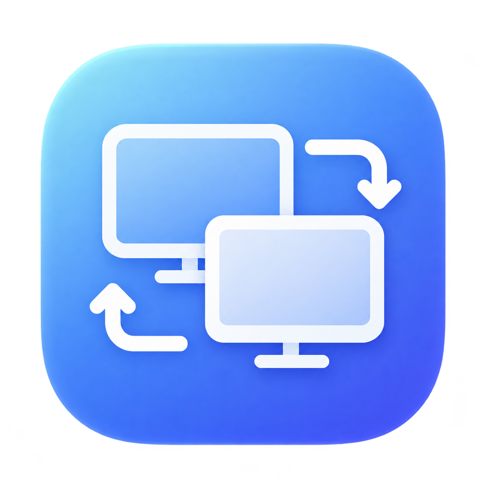
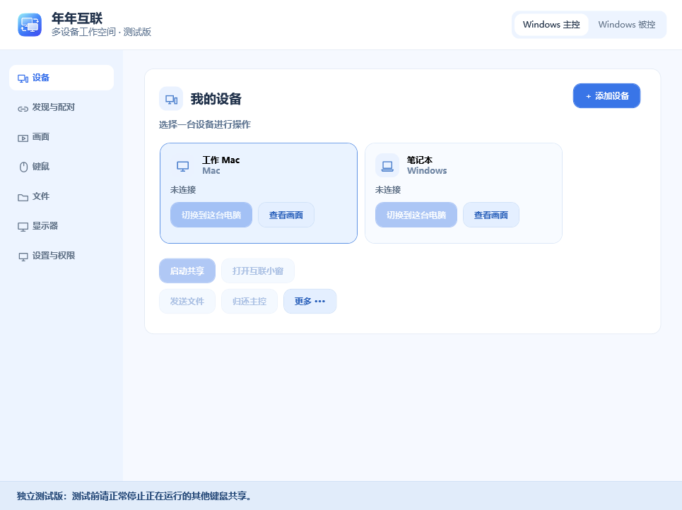
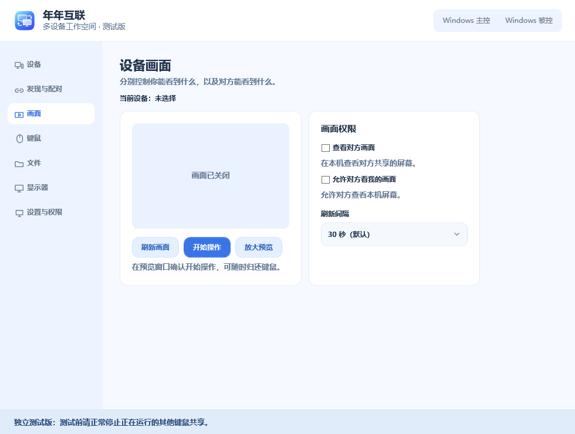
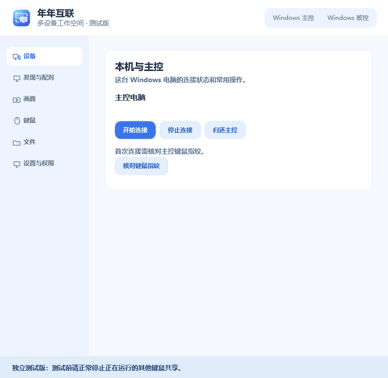
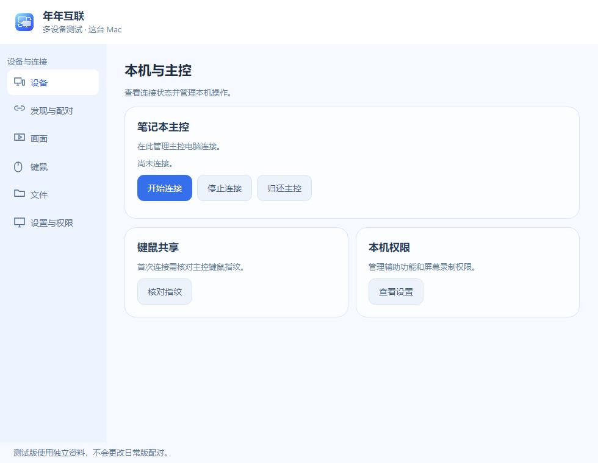
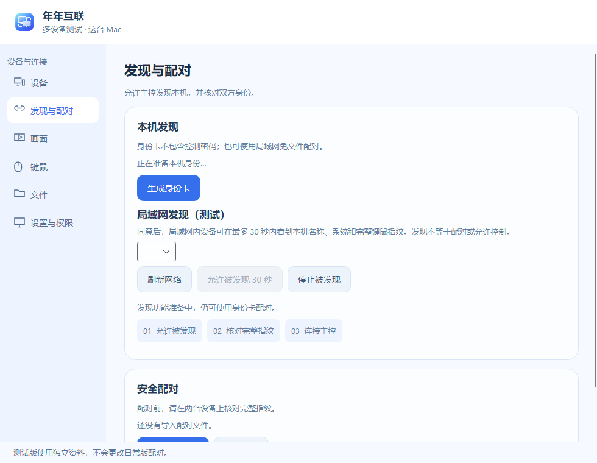
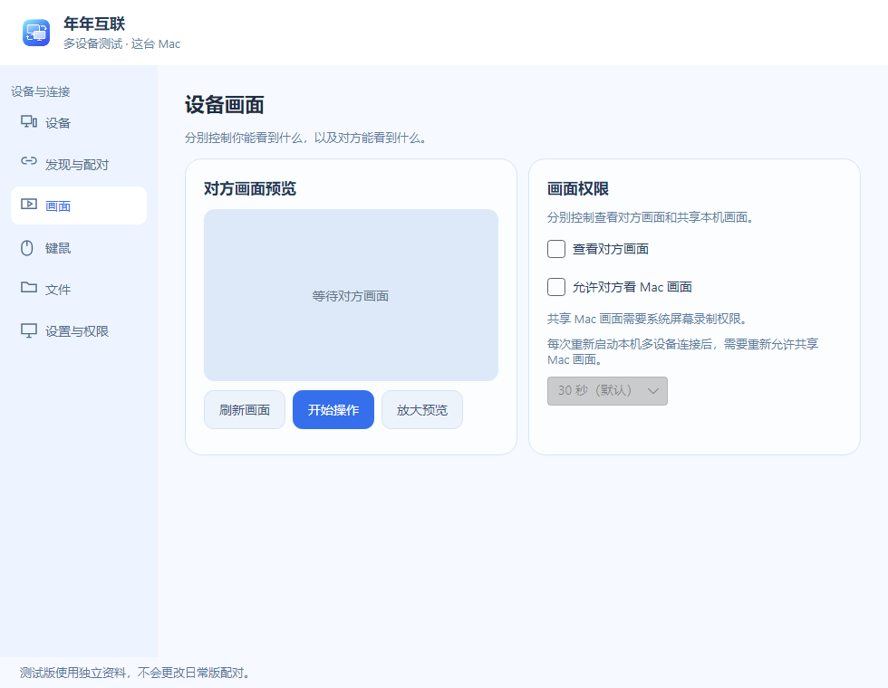
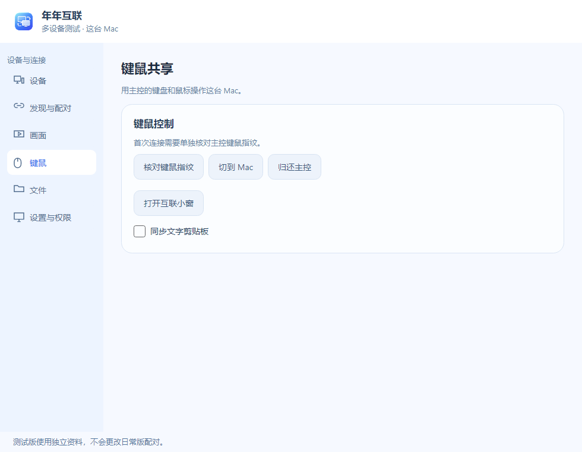
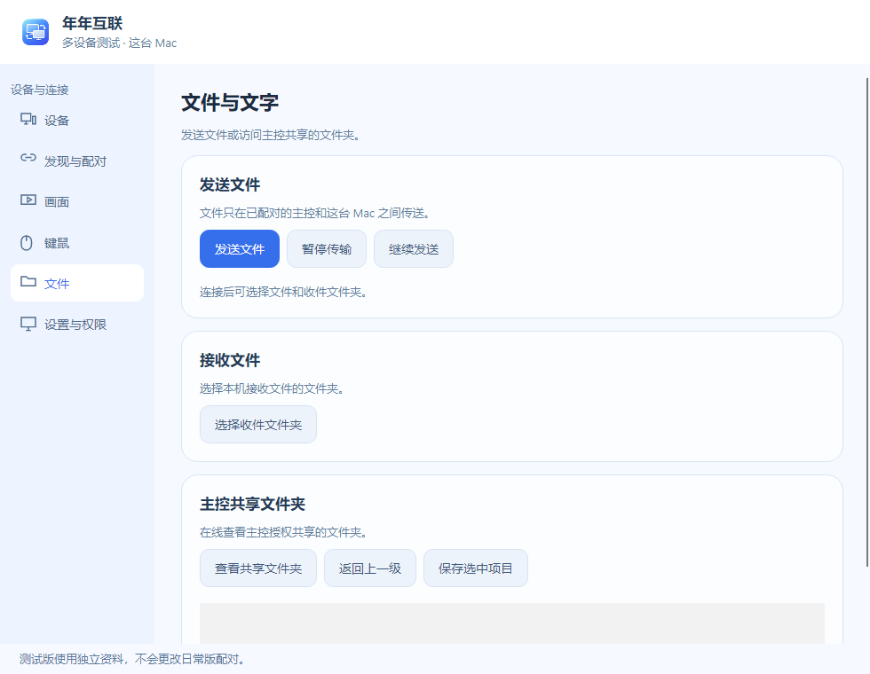

  

<h1 align="center">年年互联 · Nian Link</h1>

<strong>让同一局域网里的电脑，更轻松地一起工作。</strong>

一套键鼠切换设备 · 按需查看画面 · 传递文字与文件

Windows 主控 &nbsp;•&nbsp; Windows / Apple 芯片 Mac 被控 &nbsp;•&nbsp; 可信局域网

[使用教程](docs/使用说明.md) · [功能详解](docs/功能详解.md) · [项目进度](docs/项目进度.md) · [构建与测试](docs/构建与测试.md) · [English](README.en.md)

> **项目状态：内部开发与源码审查。** 本仓库包含源码、文档和界面示例，尚无完整验收的通用安装包。Windows 双机与 Windows–Mac 曾分别使用不同测试候选完成配对和键鼠切换；当前归还浮窗存在竞态反例，真实断网、干净设备安装及完整第三方发行许可仍需验收。不要将历史实测等同于最新版本通过验证。

[测试版使用与已知问题](docs/多设备测试版使用与已知问题-发布准备.md) · [开发技能树（下载后本地打开）](docs/进度技能树/index.html) · [Windows 测试入口说明](docs/Windows测试版独立入口方案.md)

## 这是什么？

年年互联是一款面向**可信局域网**的多设备协作项目。Windows 电脑作为主控，连接另一台 Windows 电脑或 Apple 芯片 Mac 后，可以在设备之间切换键鼠、按授权查看对方画面，并传递文字和文件。

它适合需要在身边多台电脑之间协作的场景：例如在笔记本上选择台式机，或在 Windows 与 Mac 之间切换操作。项目仍在开发，具体能力和限制见下方状态说明。

## 界面预览

*Windows 主控设备页：设备卡片、状态和常用操作。图中设备与数据均为合成示例。*

查看更多 Windows 与 Mac 界面（7 张）

**Windows：画面权限与被控设备**

| 画面权限 | 被控设备 |
| --- | --- |
|  |  |

**Mac 被控：设备、发现与画面**

| 设备 | 发现与配对 |
| --- | --- |
|  |  |

| 画面权限 | 键鼠共享 |
| --- | --- |
|  |  |

以上是隔离测试环境生成的界面图，并非真实连接或正式版截图。Windows 图由 WPF 测试夹具生成；Mac 图由 Avalonia Headless 在 Windows 上生成，**不是 Mac 真机截图**。Mac 夹具在前五页生成后，“设置与权限”窗口宽度检查失败，因此不能视为完整界面测试通过。[图片来源与核查范围 →](docs/screenshots/README.md)

## 能做什么？

| 功能 | 当前能力与验证范围 |
| --- | --- |
| **局域网发现与免文件配对** | 被控设备主动开放 30 秒供发现。双方核对完整指纹并确认，无需传递配对 JSON。Windows 双机和 Windows–Mac 历史候选各实测一次。 |
| **键鼠共享** | Windows 主控选择设备并切换操作，可通过界面或界面提示的快捷键归还。上述两种设备组合曾分别实测一次。 |
| **画面预览与操作** | “查看对方画面”和“允许对方看我的画面”分别授权，可在放大预览中操作。Mac 历史候选曾实测画面操作和归还。 |
| **文字与文件** | 支持文字、链接剪贴板及单独的文件传输；授权后可访问主控共享文件夹。图片或截图的剪贴板互传尚不支持；图片作为普通文件传输仍需在对应候选验证。 |
| **设备管理** | 查看设备卡片与连接状态，设置本地显示名；可配置最多四台被控设备，四台并发尚未验收。 |

**如何理解这些状态：**“曾实测”指历史测试候选及当时的设备，不能等同最新源码已经通过完整验收。断线自动恢复、仅键鼠应急归还、浮窗并发处理和共用显示器自动切屏仍未完成或未验收。[查看详细功能与限制 →](docs/功能详解.md)

## 如何使用？

如果已有独立测试版，可以按照以下流程体验。请使用独立测试资料，保留现用程序和原有配对资料：

1. **准备设备。** 两台设备连接同一可信局域网；Windows 选择主控，另一台选择 Windows 被控或 Mac 被控。
2. **发现设备。** 主控选择当前活动网络并点击“准备主控”；被控端选择活动网络，开启“允许被发现 30 秒”；主控扫描并发起安全配对。
3. **核对身份。** 双方逐字对照完整的对方设备键鼠指纹与主控控制通道指纹，两项均一致后分别确认。扫描结果和设备名称本身不能证明身份。
4. **建立连接。** 如主控共享尚未启动，按提示启动；被控端按提示开始连接。首次键鼠连接如再次提示指纹，先与主控显示的完整指纹核对一致，再确认。
5. **开始协作。** 在主控设备页选择目标，使用键鼠、画面或文件功能；结束操作后按界面提示归还键鼠。画面的查看与分享需要分别开启。

Mac 测试候选面向 Apple 芯片、macOS 14 或更新版本，需要 Python 3 和 Deskflow；根据系统提示授予本地网络、辅助功能或屏幕录制权限。Mac 重启多设备连接后，分享画面需要重新允许。Mac 测试包尚未公证。详细步骤、权限与排错请看[使用教程](docs/使用说明.md)。

设备间局域网仍可通信时，互联网断开与局域网断开是不同情况；如果设备之间的局域网断开，连接会受影响，当前不能承诺自动恢复。

## 文档导航

| 你想了解 | 文档 |
| --- | --- |
| 从连接到日常使用 | [使用教程](docs/使用说明.md) · [功能详解与限制](docs/功能详解.md) |
| 完成了什么、接下来做什么 | [项目进度与技能树](docs/项目进度.md) |
| 从源码构建及测试 | [构建与测试状态](docs/构建与测试.md) · [Windows 原生源码构建](docs/Windows原生源码干净构建.md) |
| 界面图片如何生成 | [截图来源与核查范围](docs/screenshots/README.md) |
| 开源许可与发行准备 | [许可与发布状态](docs/许可与发布状态.md) · [第三方组件审查](THIRD-PARTY-REVIEW.md) |

## 许可与隐私

项目中贡献者有权许可的自有代码采用 [GPL-2.0-only](LICENSE)；第三方组件保留各自版权、许可与适用例外。最终发行载荷、对应源码及分发义务仍需逐项核验，详见[许可说明](LICENSE-NOTICE.md)和[第三方通知](THIRD-PARTY-NOTICES.md)。

配对凭证、私钥、令牌、真实用户资料和设备地址不应提交到仓库。
